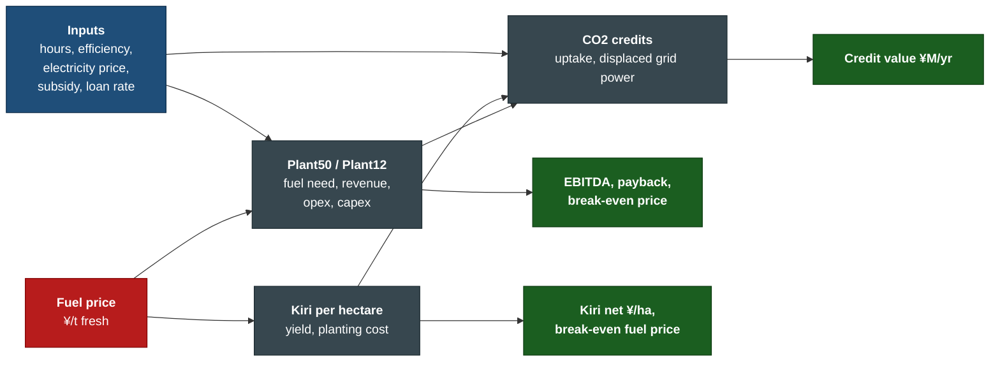
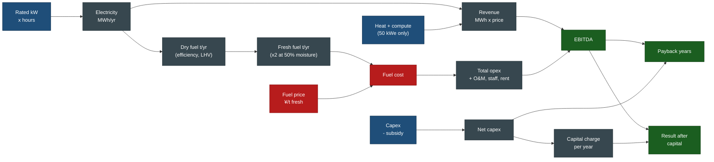
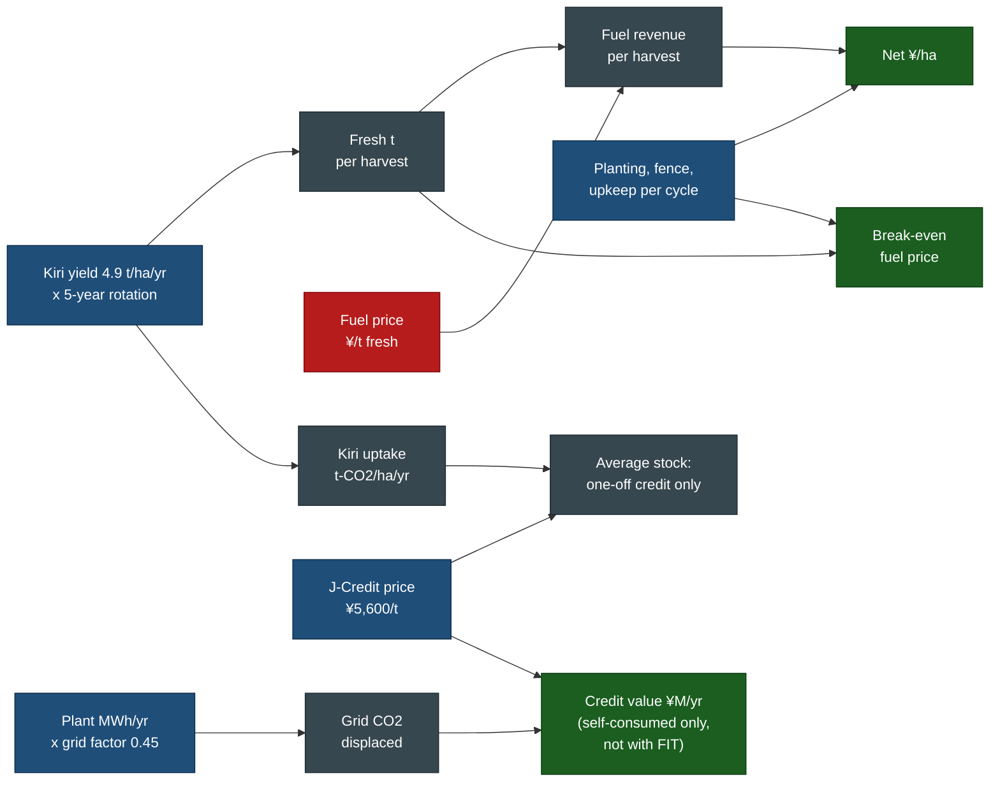

the 
Version: v1.1 | Last modified: 2026-10-31

# How the Financial Model Fits Together

Maps the sheets in the Excel model [kiri_sugi_chp_financial_model_2026-10-31.xlsx](kiri_sugi_chp_financial_model_2026-10-31.xlsx) (full path: /home/rob/Documents/Mitsue/Mitsue Village Project AI data center/docs/energy-forest/economics/kiri_sugi_chp_financial_model_2026-10-31.xlsx). Change its blue input cells to test other fuel prices, subsidies or yields. A3 PDFs: [EN](kiri_sugi_chp_model_flowchart_a3_en.pdf), [JP](kiri_sugi_chp_model_flowchart_a3_jp.pdf). Blue = inputs, green = results, red = the decisive lever. All costs are placeholders. Split into three charts so lines stay short and uncrossed.

## 1. Overview: what feeds what

## 2. Plant sheets (Plant50 and Plant12)

## 3. Kiri per hectare and CO2

## Reading it
- **Fuel price is the red lever.** It sets fuel cost (the largest opex line), so it drives EBITDA, payback and break-even price, and it also sets kiri's value per hectare.
- **Hours and efficiency** set MWh, which sets fuel need, O&M and CO2 displaced.
- **Subsidy and loan rate** only touch the capital side.
- **CO2 credits** sit outside the EBITDA chain: they count only if the power is self-consumed, and kiri stock credits are one-off.
