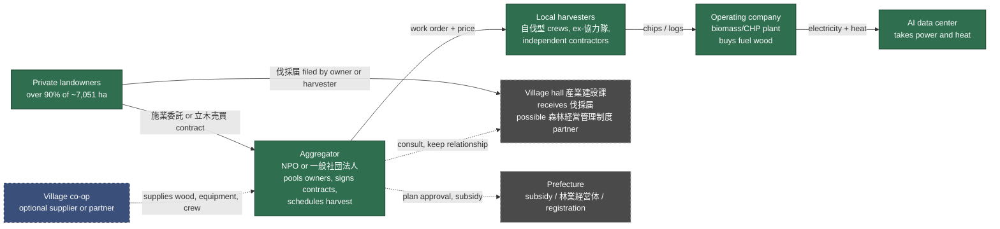
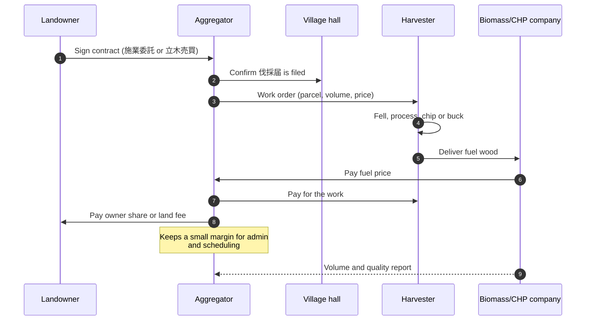
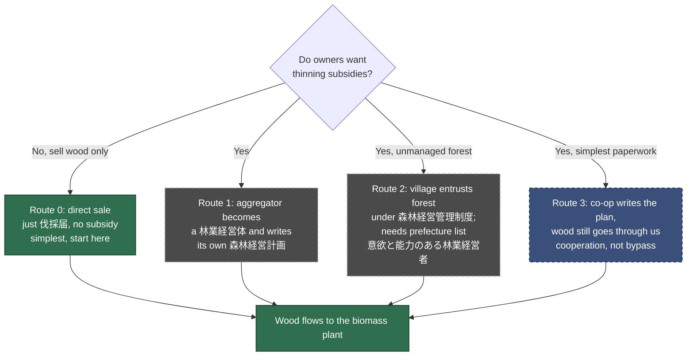
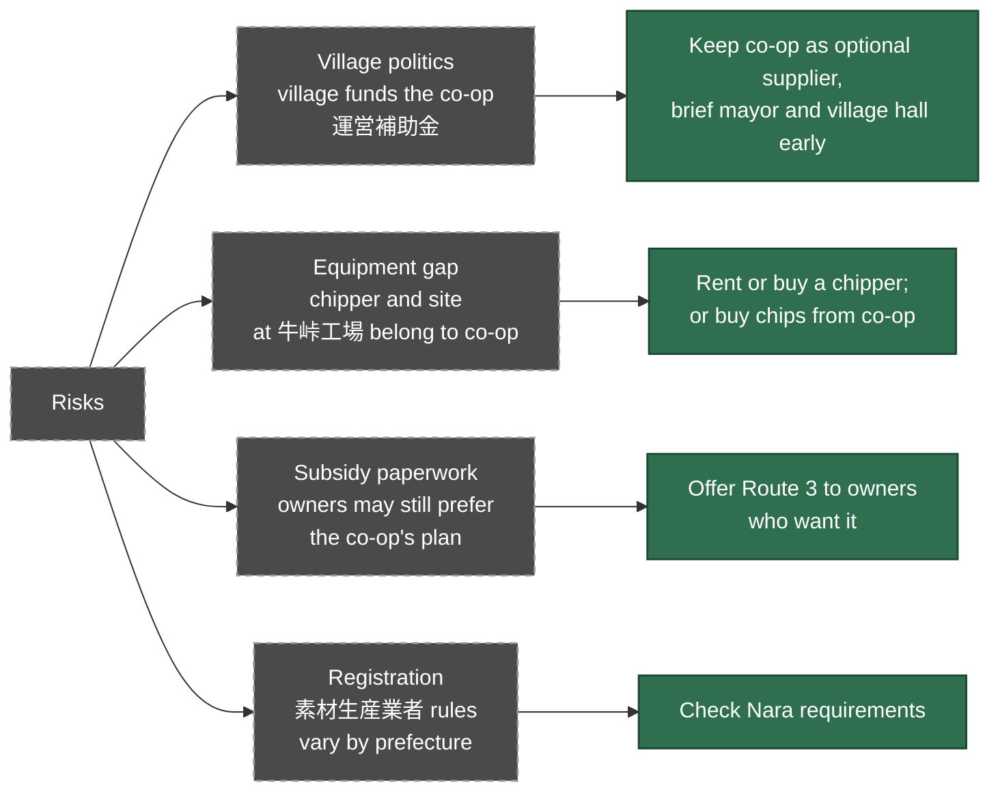

<!-- Version: v1.0 | Last modified: 2026-10-28 -->

# Independent Supply Model — Landowners → Local Harvesters → Biomass/AI Data Center

Model: our own aggregator entity connects landowners to local harvesters and to the
biomass/CHP + data center, **without depending on the Village co-op**. The co-op stays
welcome as one supplier among others, never a required channel.

**Solid arrow = how it works in principle. Dashed arrow = optional / to verify.**
Legal points are general Japanese forestry practice, NOT yet verified for Nara. See the
checklist at the end.

## 1. Structure and contracts

## 2. Wood and money flow for one harvest

## 3. Three ways to be allowed to handle subsidies (to verify)

## 4. Risks of going around the co-op

## To verify before relying on this

1. Does Nara require 素材生産業者 registration for commercial harvesting?
2. Can an NPO/一般社団法人 qualify as a 林業経営体 and submit a 森林経営計画? Minimum area?
3. How does Mitsue pick operators for 森林経営管理制度, and who is on the prefecture list?
4. Does the village require owners to use the co-op for any village-funded thinning?
5. Co-op member count and area covered (open Q1 in `meetings/village_coop_2026-10-02_prep_questions.md`).
6. Who can chip and dry fuel wood without the 牛峠 site, and at what cost per tonne?
